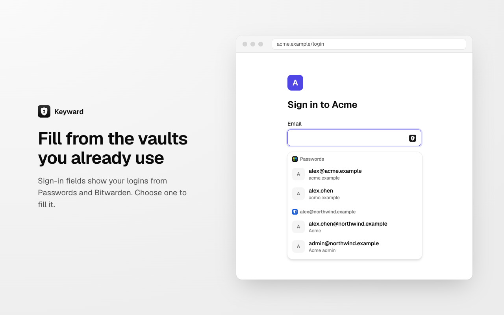
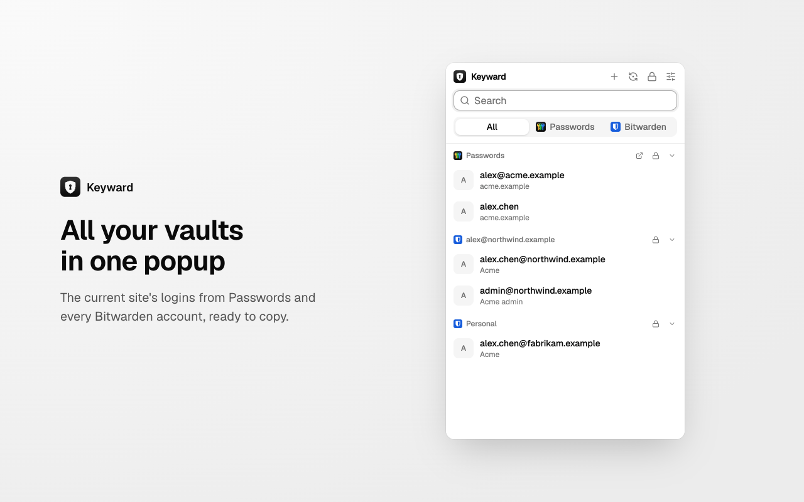
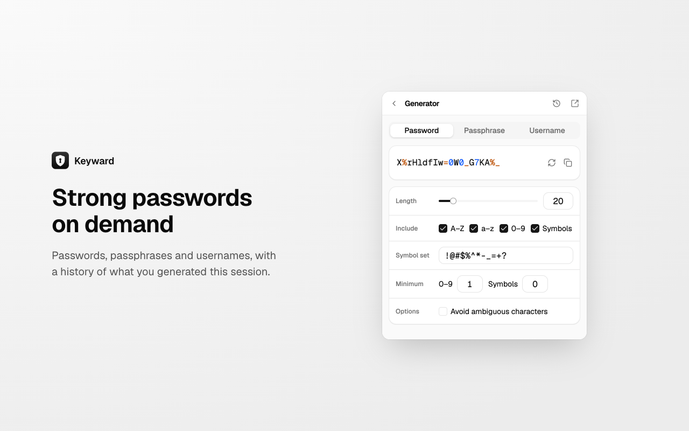
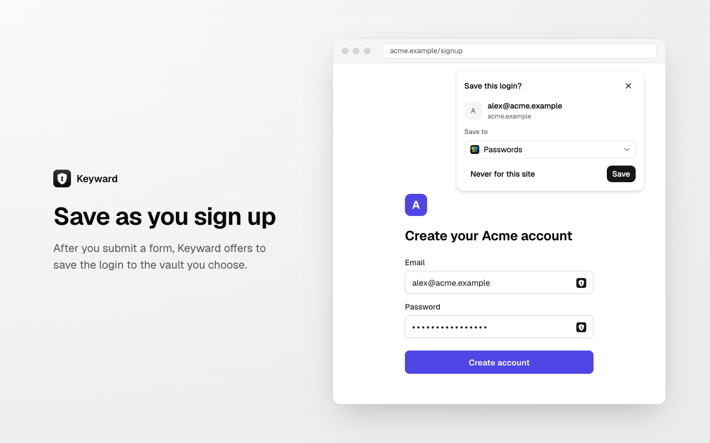
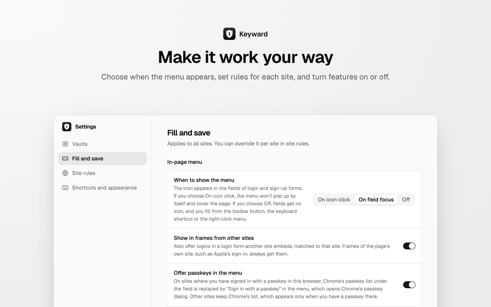

# Keyward

A browser extension for filling, generating, and saving passwords with macOS **Passwords** and **Bitwarden**.



<p>
  
  
  
  
</p>

## Build

Requires [mise](https://mise.jdx.dev) (and macOS 14 or later for Passwords).

```sh
mise install
mise run setup
mise run build
```

Open `chrome://extensions`, enable Developer mode, and load `.output/chrome-mv3` as an unpacked extension. To use Passwords on macOS, follow the connection prompt in the extension.

`mise run zip` packages the extension for the Chrome Web Store as `.output/keyward-<version>-chrome.zip`. The package carries no manifest key, since the store assigns the extension ID.

## Privacy

Keyward sends nothing to its developer. [PRIVACY.md](PRIVACY.md) describes what it handles and where the data goes.

## License

Keyward's source code is licensed under the [MIT License](LICENSE).

Built artifacts bundle `@bitwarden/sdk-internal` (GPL-3.0) and site rules from Apple's `password-manager-resources` ([MIT License](src/lib/site-data/LICENSE.apple.md)). The store package lists every bundled component with its license in `THIRD_PARTY_NOTICES.md`.
